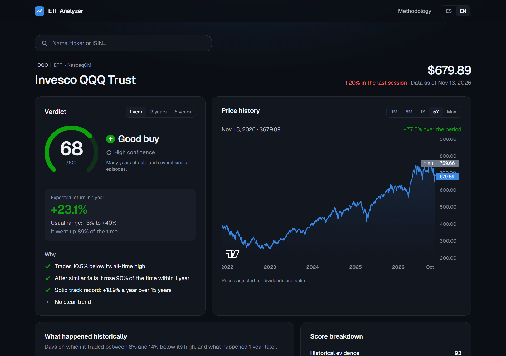
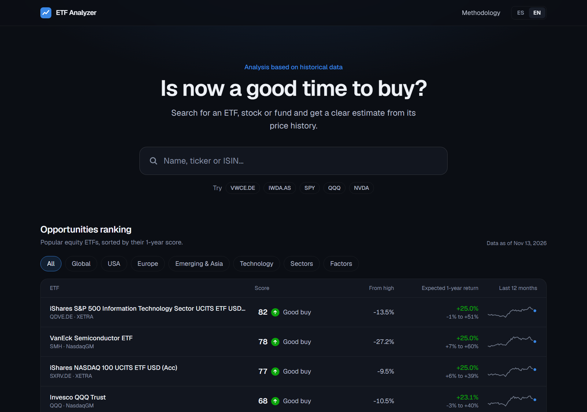
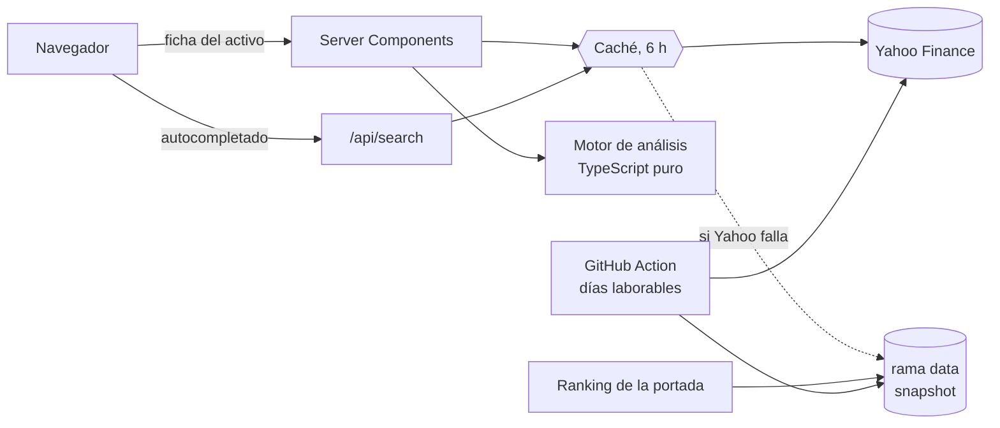

# ETF Analyzer

**¿Es buen momento para comprar?** Busca un ETF, acción o fondo y obtén una respuesta clara basada en su histórico de precios: una puntuación de 0 a 100, un veredicto, el retorno esperado y un simulador de inversión.

**Demo en vivo: [etf-analyzer-swart.vercel.app](https://etf-analyzer-swart.vercel.app/es)**

🇬🇧 [Read in English](README.md)



## Qué hace

- **Busca** cualquier ETF, acción o fondo por nombre, ticker o ISIN.
- **Veredicto** del activo: una puntuación de 0 a 100, una etiqueta (*Buena compra*, *Neutral* o *Esperar*), el retorno esperado a 1, 3 o 5 años con su rango habitual, y los motivos en lenguaje llano.
- **Evidencia histórica**: qué pasó en el pasado cada vez que el activo estuvo tan lejos de su máximo como hoy.
- **Simulador de inversión**: una inversión inicial más aportaciones mensuales, proyectadas en tres escenarios.
- **Ranking de oportunidades**: unos 40 ETFs de renta variable populares ordenados por puntuación, actualizado cada día laborable.
- En español e inglés, tema oscuro, funciona en móvil y escritorio.



## Cómo funciona la puntuación

El análisis usa **solo precios diarios**: ni fundamentales, ni noticias, ni opiniones de analistas. La puntuación se compone de cinco factores:

| Factor | Peso | Qué mide |
| --- | --- | --- |
| Evidencia histórica | 35 % | Qué ocurrió tras situaciones del pasado parecidas a la actual: cuántas veces subió, cuánto, y si fue mejor que un día cualquiera |
| Descuento desde máximos | 30 % | Cuánto ha caído desde su máximo histórico y lo inusual que es para ese activo |
| Tendencia | 15 % | Precio frente a sus medias de 50 y 200 sesiones |
| Momento | 10 % | RSI de 14 sesiones |
| Largo plazo | 10 % | Rentabilidad anual de los últimos 15 años |

El retorno esperado es la mediana de lo ocurrido tras situaciones similares, mezclada con el comportamiento habitual del activo y acercada a una referencia de mercado cuando el activo tiene poco histórico. Unos topes de prudencia evitan que un activo con un pasado excepcional prometa un futuro excepcional. La explicación completa, con todos los umbrales, está en la página **Metodología** de la app; todas las constantes viven en [`src/lib/analysis/config.ts`](src/lib/analysis/config.ts).

## Tecnologías

- [Next.js 16](https://nextjs.org) (App Router, Cache Components, Partial Prerendering) y React 19
- TypeScript, Tailwind CSS 4
- [yahoo-finance2](https://github.com/gadicc/yahoo-finance2) para los datos de mercado (solo en servidor)
- [Lightweight Charts](https://github.com/tradingview/lightweight-charts) para el gráfico de precios y [Recharts](https://recharts.org) para el simulador
- [Vitest](https://vitest.dev) para el motor de análisis
- GitHub Actions para la integración continua y la actualización diaria de datos; desplegado en Vercel

## Arquitectura



- **`src/lib/analysis`** — el motor: indicadores, caídas desde máximos, evidencia histórica, puntuación y el simulador por bootstrap. Funciones puras, sin código del framework y con tests unitarios. El simulador se ejecuta en el navegador para que los controles respondan al instante.
- **`src/lib/market-data`** — todo lo que habla con Yahoo Finance, limpia las series y cachea el resultado. Las páginas nunca llaman a Yahoo directamente.
- **`scripts/build-snapshot.ts`** — calcula el ranking del universo de ETFs. Una GitHub Action programada lo publica en la rama `data`, de modo que el ranking no depende de Yahoo en cada visita y `main` no se llena de commits automáticos.

## Puesta en marcha

Requiere Node.js 22 o posterior.

```bash
npm install
npm run dev
```

Abre <http://localhost:3000>. No hace falta ninguna clave de API.

| Script | Qué hace |
| --- | --- |
| `npm run dev` | Servidor de desarrollo |
| `npm run build` / `npm start` | Compilación y servidor de producción |
| `npm test` | Tests unitarios del motor de análisis |
| `npm run lint` / `npm run typecheck` | Linter y comprobación de tipos |
| `npm run analyze -- NVDA VWCE.DE` | Muestra en la terminal el análisis de uno o varios símbolos |
| `npm run snapshot -- --seed` | Recalcula el ranking y la copia incluida en la app |

## Despliegue

1. Importa el repositorio en [Vercel](https://vercel.com/new). No necesita variables de entorno.
2. En GitHub, ejecuta una vez el workflow **Refresh market data** (pestaña Actions) para crear la rama `data`. Después se ejecuta solo cada día laborable.

La app localiza automáticamente la rama `data` de su propio repositorio. Mientras esa rama no exista, usa el snapshot incluido en `src/data/seed-snapshot.json`.

## Aviso

ETF Analyzer es un proyecto educativo. No es asesoramiento financiero ni una recomendación de inversión. Rentabilidades pasadas no garantizan rentabilidades futuras. Los datos de mercado proceden de Yahoo Finance a través de una API no oficial y pueden llegar con retraso o contener errores.

## Licencia

[MIT](LICENSE)
