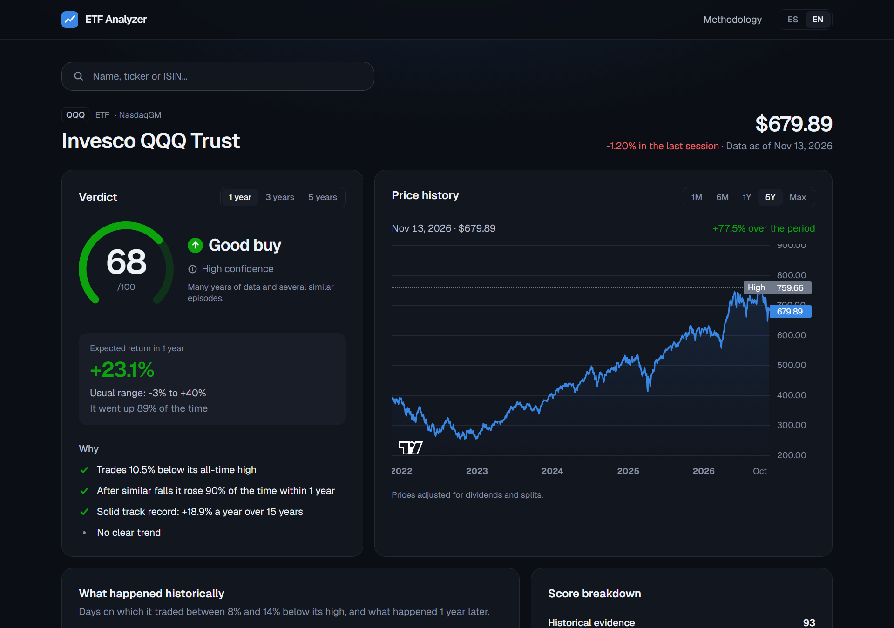
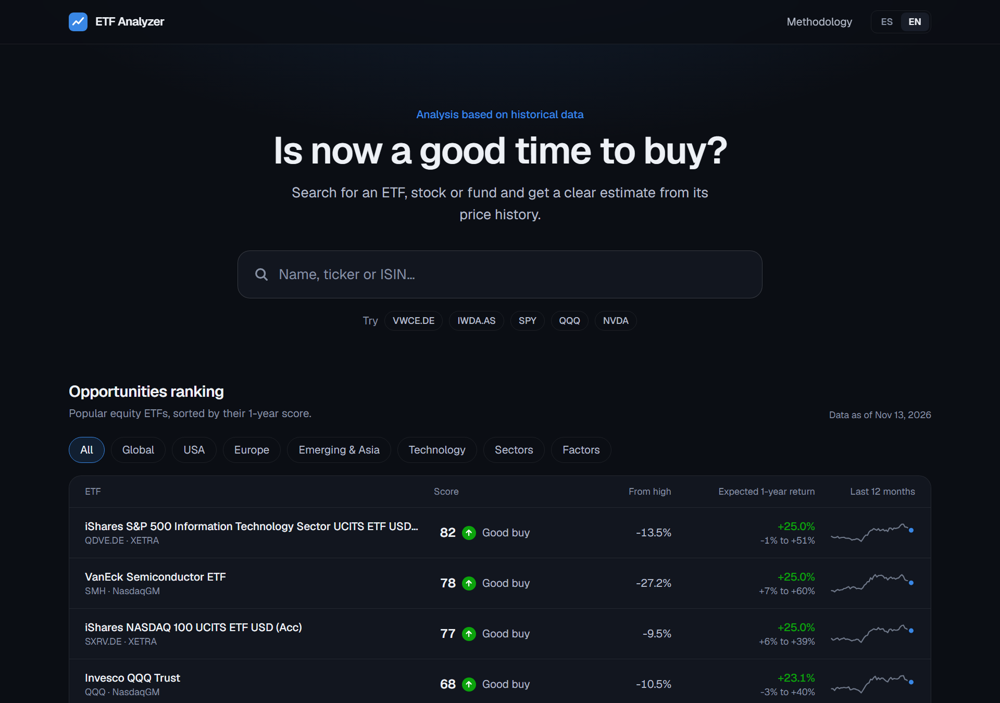
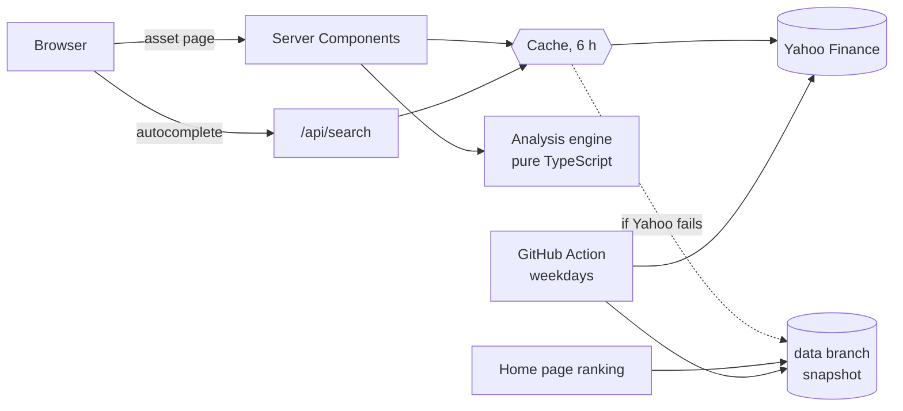

# ETF Analyzer

**Is now a good time to buy?** Search for an ETF, stock or fund and get a clear, data-driven answer based on its price history: a 0–100 score, a verdict, the expected return and an investment simulator.

**Live demo: [etf-analyzer-swart.vercel.app](https://etf-analyzer-swart.vercel.app/en)**

🇪🇸 [Leer en español](README.es.md)



## What it does

- **Search** any ETF, stock or fund by name, ticker or ISIN.
- **Verdict** for the asset: a score from 0 to 100, a label (*Good buy*, *Neutral* or *Wait*), the expected return over 1, 3 or 5 years with its usual range, and the reasons behind it in plain language.
- **Historical evidence**: what happened in the past every time the asset was as far from its high as it is today.
- **Investment simulator**: a lump sum plus monthly contributions projected in three scenarios.
- **Opportunities ranking**: around 40 popular equity ETFs sorted by score, refreshed every weekday.
- Spanish and English, dark theme, works on phones and desktops.



## How the score works

The analysis uses **only daily prices** — no fundamentals, news or analyst opinions. Five factors make up the score:

| Factor | Weight | What it measures |
| --- | --- | --- |
| Historical evidence | 35 % | Outcomes after past situations similar to today's: how often it rose, by how much, and whether that beat an ordinary day |
| Discount from high | 30 % | How far it has fallen from its all-time high and how unusual that is for this asset |
| Trend | 15 % | Price against its 50 and 200-session averages |
| Momentum | 10 % | 14-session RSI |
| Long run | 10 % | Annual return over the last 15 years |

The expected return is the median outcome after similar situations, blended with the asset's usual behaviour and pulled towards a market reference when the asset has little history. Prudence ceilings stop assets with an exceptional past from promising an exceptional future. The full explanation, with every threshold, is on the app's **Methodology** page; every constant lives in [`src/lib/analysis/config.ts`](src/lib/analysis/config.ts).

## Tech stack

- [Next.js 16](https://nextjs.org) (App Router, Cache Components, Partial Prerendering) and React 19
- TypeScript, Tailwind CSS 4
- [yahoo-finance2](https://github.com/gadicc/yahoo-finance2) for market data (server only)
- [Lightweight Charts](https://github.com/tradingview/lightweight-charts) for the price chart and [Recharts](https://recharts.org) for the simulator
- [Vitest](https://vitest.dev) for the analysis engine
- GitHub Actions for CI and the daily data refresh; deployed on Vercel

## Architecture



- **`src/lib/analysis`** — the engine: indicators, drawdowns, historical evidence, scoring and the bootstrap simulator. Pure functions with no framework code, covered by unit tests. The simulator runs in the browser so the sliders respond instantly.
- **`src/lib/market-data`** — everything that talks to Yahoo Finance, cleans the series and caches the result. Pages never call Yahoo directly.
- **`scripts/build-snapshot.ts`** — computes the ranking for the ETF universe. A scheduled GitHub Action publishes it on the `data` branch, so the ranking never depends on Yahoo at request time and `main` stays free of automated commits.

## Getting started

Requires Node.js 22 or later.

```bash
npm install
npm run dev
```

Open <http://localhost:3000>. No API keys are needed.

| Script | What it does |
| --- | --- |
| `npm run dev` | Development server |
| `npm run build` / `npm start` | Production build and server |
| `npm test` | Unit tests of the analysis engine |
| `npm run lint` / `npm run typecheck` | Linter and type checker |
| `npm run analyze -- NVDA VWCE.DE` | Prints the analysis of one or more symbols in the terminal |
| `npm run snapshot -- --seed` | Rebuilds the ranking and the copy bundled with the app |

## Deploying

1. Import the repository in [Vercel](https://vercel.com/new). No environment variables are required.
2. In GitHub, run the **Refresh market data** workflow once (Actions tab) to create the `data` branch. After that it runs by itself every weekday.

The app finds the `data` branch of its own repository automatically. Until that branch exists, it uses the snapshot bundled in `src/data/seed-snapshot.json`.

## Disclaimer

ETF Analyzer is an educational project. It is not financial advice or an investment recommendation. Past performance does not guarantee future results. Market data comes from Yahoo Finance through an unofficial API and may be delayed or inaccurate.

## License

[MIT](LICENSE)
